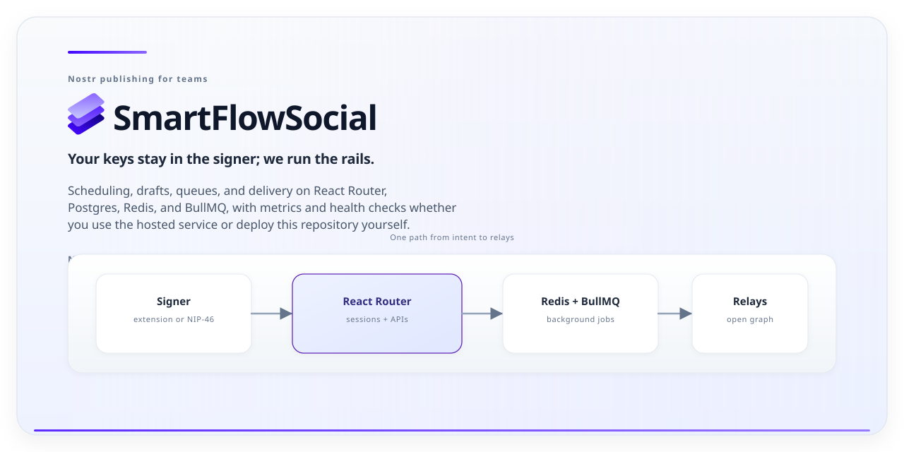

# SmartFlowSocial

A scheduler for Nostr. Sign posts with your own signer. They go out on schedule, even while you are
offline.

You sign with a NIP-07 browser extension, such as Alby or nos2x, or with a NIP-46 remote signer,
such as Amber or nsecBunker. The server stores that signed event and publishes it later. Your Nostr
signing key stays in the signer.

The same code is the hosted service and a self-hosted install. There is no private edition of the
scheduler. A running deploy can lag this commit until the operator updates it. The license is the
[Unlicense](LICENSE).

**SmartFlowSocial v1 — Now Open Source.** The published release is
[`v1.0.0-beta.2`](https://github.com/smartflowsocial/smartflowsocial/releases/tag/v1.0.0-beta.2) at
`5be28add1a8ef1d078e8ba9c885ca68249d0a54f`. That tag's `package.json` still says `1.0.0-beta.1`. The
tag is not rewritten. This source tree also reports `1.0.0-beta.1` until the next release is
prepared. A future tag must match `package.json`;
`node scripts/check-release-version.mjs --tag v<version>` rejects a mismatch. This is not a stable
`1.0.0`. Notes for the published release are in
[docs/releases/v1.0.0-beta.2.md](./docs/releases/v1.0.0-beta.2.md). `v0.1.0-alpha.0` and a withdrawn
`v1.0.0` were published from an earlier repository. Neither is a supported version of this
repository.



[](https://github.com/smartflowsocial/smartflowsocial/actions/workflows/ci.yml)
[](https://nodejs.org/)
[](https://pnpm.io/)
[](https://reactrouter.com/)
[](https://www.postgresql.org/)
[](https://redis.io/)
[](LICENSE)

[Use the hosted service](https://smartflow.social) · [Run it yourself](#run-it-yourself) ·
[Documentation](./docs/README.md)

---

## What it is for

Write a batch of posts, put them on a queue, and attach reposts, quotes, and replies while you
draft. Plan them on a calendar. At the time you set, the worker publishes the event you already
signed. If publishing fails, the worker retries that job.

Drafts, templates, long-form articles (NIP-23), media, an engagement feed, signed DM broadcasts,
giveaways, and contests are in the same app. Lightning payouts can use NWC or BTCPay when those are
configured. Blastr, Blossom, and NostrMash are separate projects. Profile and thread reads run in
this app and cache in Redis. Scheduling does not require them.

The [feature coverage matrix](./docs/reference/feature-coverage-matrix.md) maps each area to its
documentation. It is an index of the docs, not a guarantee that every path is finished.

---

## Use the hosted service

1. Open [smartflow.social](https://smartflow.social).
2. Sign in with your signer.
3. Write a post and send it now, or schedule it. A scheduled post has to be signed before it can go
   out.

Next: [Hosted setup](./docs/getting-started/hosted.md) ·
[Posting](./docs/guides/user-guides/posting.md) · [Calendar](./docs/guides/user-guides/calendar.md)

---

## Run it yourself

You need Node.js 26.13.1 or newer, pnpm 12.21.0 (Corepack), PostgreSQL, and Redis. A fresh install
is self-hosted, including a production build. Signed events are published from this process, and
Nostr reads stay in this process with Redis as the cache. That does not need a Cloudflare Worker, a
publisher URL, or a cache URL. Uploads need S3-compatible storage when you use them. First-time
setup is about 30–60 minutes. [Self-host smoke](./docs/getting-started/self-host-smoke.md) is the
short path. `pnpm test:self-host-acceptance` boots the built server and worker and delivers a signed
note to a loopback relay. `pnpm test:relay-publish` does the same through the publish job. Managed
hosting sets `SFS_DEPLOYMENT_MODE=hosted`.

Install a published release by checking out its tag and following the README in that commit.
`v1.0.0-beta.2` is the current published release. The commands below match this source tree, which
is ahead of that tag. Do not mix this README with an older checkout.

```bash
git clone https://github.com/smartflowsocial/smartflowsocial.git
cd smartflowsocial
pnpm install
cp example.env .env
pnpm docker
pnpm exec prisma generate
pnpm exec prisma migrate deploy
pnpm db:seed
pnpm dev
```

Open `http://localhost:3000`.

`pnpm docker` starts only Postgres and Redis from [`docker-compose.yml`](./docker-compose.yml).
Postgres is published on **127.0.0.1:5433** (container port `5432`). Redis is on **127.0.0.1:6379**.
Those ports are not bound on every interface. The database name in that compose file is `postgres`,
and the password there is for local development. Point `DATABASE_URL` and `REDIS_URL` at `127.0.0.1`
before `prisma migrate deploy` or `pnpm dev`. `example.env` sets `SFS_DEPLOYMENT_MODE=self_hosted`.
An empty mode is also self-hosted, including a production build, so this install is not limited by
hosted plan caps and the platform commission is 0%. `app.smartflow.social` and
`staging.smartflow.social` refuse to start unless the mode is `hosted`. Publishing and reads run in
this process. This install does not include hosted Blossom or hosted Blastr. `pnpm db:seed` replaces
plan rows. A database that already has subscriptions should not be seeded.

`pnpm dev` starts the web server and the worker, and restarts the worker when its files change.
`pnpm worker:local` runs the worker without the web server. Running it next to `pnpm dev` starts a
second worker.

After `pnpm build`, `pnpm start` runs the web server and one worker, and exits if either stops.
`pnpm start:server` and `pnpm start:worker` run them as separate processes. These commands load
`.env` from the working directory when that file exists, and they leave variables that are already
set in the environment alone.

Copy [`example.env`](./example.env) and fill the storage, session, and Nostr variables for the paths
you use. Optional services are listed in [Configuration](./docs/reference/configuration.md).

| Check          | Address                                                                            |
| -------------- | ---------------------------------------------------------------------------------- |
| Web            | `http://localhost:3000`                                                            |
| Web metrics    | `http://localhost:3010/metrics` (`METRICS_PORT`)                                   |
| Worker metrics | `http://localhost:3011/metrics` (`WORKER_METRICS_PORT`), while a worker is running |

On a healthy `pnpm dev`:

```bash
curl -i http://localhost:3000/healthcheck
curl -I http://localhost:3000
curl http://localhost:3010/metrics
curl http://localhost:3011/metrics
```

`/healthcheck` returns `200` and `OK`. `X-Source-Commit` is the commit baked into that build, or
`unknown` when the image was built without one. A green CI run does not fill that header on a server
that was not built from the same commit. `Accept: application/json` returns the same fields plus
`publisherBackend` and `nostrReadBackend`. `/` returns success or a redirect. `/metrics` returns
Prometheus text.

Next: [Quickstart](./docs/getting-started/quickstart.md) ·
[Installation](./docs/getting-started/installation.md) · [Deployment](./docs/guides/deployment.md) ·
[Operations](./docs/guides/operations.md)

---

## Where to go next

| If you are…               | Start here                                             | Then                                                   |
| ------------------------- | ------------------------------------------------------ | ------------------------------------------------------ |
| Using the hosted service  | [Hosted quick start](./docs/getting-started/hosted.md) | [Posting guide](./docs/guides/user-guides/posting.md)  |
| Self-hosting              | [Local setup](./docs/getting-started/quickstart.md)    | [Installation](./docs/getting-started/installation.md) |
| Deploying                 | [Deployment guide](./docs/guides/deployment.md)        | [Operations](./docs/guides/operations.md)              |
| Calling the API           | [API reference](./docs/reference/api.md)               | [API development](./docs/guides/api-development.md)    |
| Contributing              | [CONTRIBUTING.md](./CONTRIBUTING.md)                   | [Testing guide](./docs/guides/testing.md)              |
| Looking up a term         | [Glossary](./docs/meta/glossary.md)                    | [Core concepts](./docs/getting-started/concepts.md)    |
| Reporting a vulnerability | [SECURITY.md](./SECURITY.md)                           | [Security guide](./docs/guides/security.md)            |

Full index: [docs/README.md](./docs/README.md)

---

## How it is built

- [React Router](https://reactrouter.com/) 8.5.1 and TypeScript for the web app (React 19.2.7)
- PostgreSQL and Prisma for stored data
- Redis and BullMQ for the worker's jobs
- NIP-07 and NIP-46 for signing

Deeper map: [Architecture](./docs/getting-started/architecture.md). Threat boundaries:
[Threat model](./docs/reference/threat-model.md).

---

## Repository

- `app/` — React Router routes, features, and server modules
- `prisma/` — schema, migrations, and seed
- `docs/` — guides, reference, and operations
- `tests/` — unit, integration, Cypress, security, and performance
- `scripts/` — build and maintenance helpers
- `public/` — static assets

```bash
pnpm lint
pnpm typecheck
pnpm test
```

More suites: [Testing guide](./docs/guides/testing.md). Workflow:
[CONTRIBUTING.md](./CONTRIBUTING.md).

---

## Community

- Hosted service: [smartflow.social](https://smartflow.social)
- Bugs and features: [Issues](https://github.com/smartflowsocial/smartflowsocial/issues)
- Questions: [Discussions](https://github.com/smartflowsocial/smartflowsocial/discussions)
- Changes: [CHANGELOG.md](./CHANGELOG.md)

[CONTRIBUTING.md](./CONTRIBUTING.md) · [SECURITY.md](./SECURITY.md) ·
[CODE_OF_CONDUCT.md](./CODE_OF_CONDUCT.md)

---

## License

[Unlicense](./LICENSE). Public domain.
